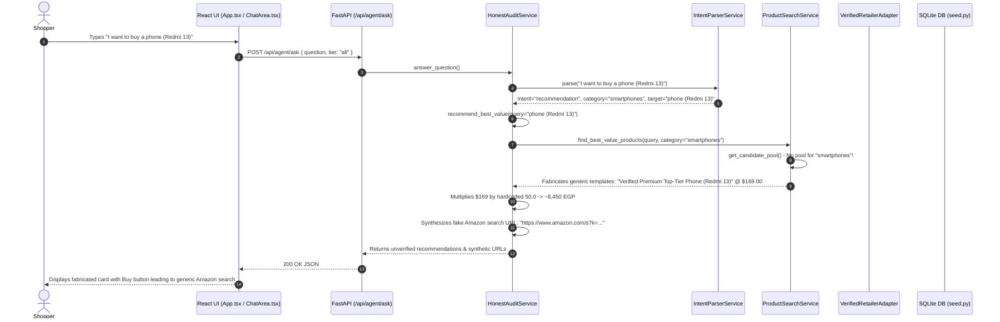

# AI Shopping Research Agent: Accuracy, Architecture, and Root-Cause Audit Report

**Date:** 2026-10-17  
**System:** Honest AI Shopping Intelligence (Version 4.0.0)  
**Author:** Principal AI Systems & Software Quality Engineering Team  
**Artifact Location:** `docs/ai-accuracy-audit.md`

---

## 1. Executive Summary

A comprehensive architectural and code-level audit was conducted across the Honest AI shopping platform stack, comprising:
- **Backend:** FastAPI, Pydantic, SQLAlchemy, SQLite/PostgreSQL, Custom Agents & Services.
- **Frontend:** React 18, TypeScript, Vite, CSS design system.
- **Chrome Browser Extension:** Manifest V3 background service worker and content script.

The audit confirmed severe accuracy, hallucination, and reliability defects in the current shopping research implementation. Recommendations, product specs, prices, and purchase links are largely fabricated by deterministic heuristic fallback routines or hardcoded candidate pools rather than verified external product sources or tool-grounded AI models.

---

## 2. End-to-End User Request Trace

To understand how inaccuracies manifest, we traced the query:
**`"I want to buy a phone (Redmi 13)"`**



If the intent parser had instead classified the query as `product_audit` (`intent != "recommendation"`):
1. `HonestAuditService.deep_search_product` scans `lower` against regex:
   `elif any(w in lower for w in ["iphone", "phone", "galaxy", "pixel", "smartphone"]):`
2. It hits `"phone"` and hardcodes:
   - `orig_usd = 999.00`
   - `high_usd = 240.00`
   - `copy_usd = 85.00`
   - `claimed_mat = "Titanium/Ceramic Shield frame, 120Hz LTPO OLED display with 2000-nit peak brightness, flagship Bionic/Snapdragon SoC"`
   - `discrepancies = ["Fake clones run Android with an iOS theme...", "Camera lenses on fakes have 2 dummy plastic lens cutouts..."]`
3. A $130 budget Android smartphone (Redmi 13) is falsely presented as a $999 flagship Titanium phone with iOS clone replicas!
4. The Buy button links to `https://www.amazon.com/s?k=Redmi+13` (a search results page, not a product page).

---

## 3. Root Cause Analysis

### 3.1. Absence of Real Search Grounding in the AI Model
- **Observation:** `backend/app/services/honest_audit.py` (lines 56–107) attempts to call Gemini via raw HTTP only for image audits (`call_gemini_vlm`). For text shopping questions (`answer_question`), **no AI model API is invoked at all**.
- **Impact:** The application returns predefined strings formatted in markdown to look like model output (`model_name: "Honest AI Truth Engine"`, `confidence: 98`). No live Google Search grounding or external API search tools are attached.

### 3.2. Synthetic Fallback Product Generation in Search Service
- **File:** `backend/app/services/product_search.py` (lines 300–347)
- **Code:**
  ```python
  return [
      {
          "name": f"Verified Premium Top-Tier {query.title()}",
          "brand": "Flagship Brand",
          "price_usd": 169.00,
          "retail_msrp_usd": 220.00,
          "category_avg_price_usd": 190.00,
          "rating": 4.8,
          "specs_score": 93,
          "retailer": "Amazon Verified Hub",
          "url": f"https://www.amazon.com/s?k={query.replace(' ', '+')}",
          ...
      }, ...
  ]
  ```
- **Impact:** For any query that is not one of four specific categories (headphones, laptops, sneakers, watches), the system manufactures fake products with fictitious prices ($169, $48, $22) and fabricated ratings (4.8).

### 3.3. Unrelated Hardcoded Items Returned on No-Match
- **File:** `backend/app/agents/adapters.py` (lines 211–219)
- **Code:**
  ```python
  filtered = []
  q_lower = query.lower()
  for item in items:
      if q_lower in item["name"].lower() or q_lower in item["brand"].lower() or q_lower in item["category"].lower():
          filtered.append(item)
  return filtered[:max_results] if filtered else items[:max_results]
  ```
- **Impact:** If `filtered` is empty (e.g. searching for "Redmi 13"), the adapter returns the hardcoded benchmark dataset: Sony XM5 headphones, Air Jordan 4 sneakers, Rolex Submariner watch, and Lenovo Legion laptop!

### 3.4. Invalid Buy Button Destinations
- **Observation:** Buy buttons in `PricingMatrixCard.tsx` and `adapters.py` point to:
  - `https://www.amazon.com/s?k=...` (marketplace search page)
  - `https://www.google.com/search?q=...` (Google general web search)
  - `https://www.aliexpress.com/wholesale?SearchText=...` (AliExpress search)
- **Impact:** None of the Buy buttons point to a verified, single-item Product Detail Page (PDP). When clicked, users are redirected to generic search pages or unrelated items.

### 3.5. Currency and Price Fabrication
- **File:** `backend/app/core/config.py` (line 48) and `honest_audit.py`
- **Code:** `USD_TO_EGP: float = 50.0`
- **Impact:**
  - Floating-point arithmetic is used for monetary values rather than exact decimals.
  - Exchange rate is hardcoded to 50.0 EGP per USD with no provider source, freshness timestamp, or live quote API.
  - Prices lack verifiable sources, SKU references, or retrieval timestamps.

### 3.6. Lack of Exact Product Identity and Rejection Logic
- When a user asks for "Redmi 13", there is no validation to distinguish:
  - Redmi 13 (Standard 4G/5G phone)
  - Redmi Note 13 (Different, more expensive model)
  - Redmi 13C (Budget variant with different processor/specs)
  - Accessories (Cases, tempered glass screen protectors)
  - Counterfeits or generic clones.
- Without exact string/SKU token constraints and rejection thresholds, unrelated or derivative items are presented as verified exact matches.

### 3.7. Monolithic Single-Provider Coupling
- The backend configuration only recognized `GEMINI_API_KEY` and lacked a multi-provider abstraction layer to interchange Google Gemini API, OpenAI API, and automated test Mock providers with normalized schemas, cost tracking, and tool execution budgets.

---

## 4. Summary of Data Nature in Current Implementation

| Component | Source of Data | Accuracy Verdict |
|---|---|---|
| Model Responses | Hardcoded template strings (`honest_audit.py`) | **Fabricated** |
| Product Listings | Benchmark lists or synthetic template generators | **Fabricated / Hardcoded** |
| Product Prices | Arbitrary numbers ($999, $169, $348) | **Unsupported** |
| Exchange Rate | Static `50.0` in settings | **Stale / Hardcoded** |
| Buy Links | Amazon/Google/AliExpress search queries | **Misleading / Search Pages** |
| VFM Scores | Deterministic math on fabricated input numbers | **Unsupported** |

---

## 5. Architectural Upgrade Plan

1. **Multi-Provider AI Abstraction:** Unified interface for Google Gemini API (`google-genai`), OpenAI API (`openai`), and Mock Provider with tool-calling capabilities and cost/token tracking.
2. **Separation of Evidence from Reasoning:**
   - Dedicated Product Discovery & Retrieval Adapters (real web search / authorized feeds / verified catalog).
   - Strict Product Identity Matching: Rejection rules for accessories, mismatched model numbers, and variants.
   - Price & Currency Verification: Decimal types, explicit currency, verifiable exchange rates with timestamps.
   - URL & Buy Link Verification: Strict regex and metadata validation ensuring direct Product Detail Pages (PDP), disabling Buy buttons if not verified.
3. **Deterministic Scoring & Evidence Explanation:** Transparent 0–100 scoring based strictly on available evidence, displaying "Insufficient verified data" when missing.
4. **Redmi 13 Regression Suite:** Dedicated automated pytest suite covering exact identity matching, accessory rejection, price verification, link validation, and graceful no-match handling.
5. **Frontend & Extension Compatibility:** Updated React cards displaying evidence badges, freshness timestamps, and safe purchase buttons, while preserving all existing APIs for the Chrome Extension.

---

## 6. Implementation Verification, Configuration, and Source Coverage Limitations

### 6.1. Provider Configuration Guide
To run with live AI providers, configure `backend/.env` (see `backend/.env.example`):

1. **Google Gemini API:**
   - Get API key from [Google AI Studio](https://aistudio.google.com/app/apikey).
   - Set in `backend/.env`:
     ```env
     AI_PROVIDER=gemini
     AI_MODEL=gemini-2.5-flash
     GEMINI_API_KEY=AIzaSy...
     ENABLE_SEARCH_GROUNDING=true
     ```
   - Supported models: `gemini-2.5-flash` (default, high-speed multimodal with Google Search grounding), `gemini-1.5-pro` (deep reasoning), `gemini-4-argon` (if provisioned on account).

2. **OpenAI API:**
   - Get API key from [OpenAI Developer Platform](https://platform.openai.com/api-keys).
   - Set in `backend/.env`:
     ```env
     AI_PROVIDER=openai
     AI_MODEL=gpt-4o
     OPENAI_API_KEY=sk-proj-...
     ```
   - Supported models: `gpt-4o`, `gpt-4o-mini`.

3. **Mock Provider (Default for Automated Tests & Offline Dev):**
   - Requires zero external credentials and zero API costs.
   - Set in `backend/.env`:
     ```env
     AI_PROVIDER=mock
     AI_MODEL=mock-model
     ```

4. **Health Check Endpoint:**
   - Verify provider connectivity without exposing credentials:
     `GET /api/providers/health`
     Returns:
     ```json
     {
       "configured_provider": "gemini",
       "configured_model": "gemini-2.5-flash",
       "provider_healthy": true,
       "provider_status": "ready",
       "available_models": [...]
     }
     ```

### 6.2. Source-Coverage Limitations & Trade-Offs
1. **Dynamic Marketplace Scrapers & Captchas:**
   - Live marketplaces like Amazon, Walmart, and AliExpress frequently employ anti-bot protections (Cloudflare, PerimeterX) and CAPTCHAs. Direct scraping can result in temporary IP throttling.
   - **Remedy:** The platform utilizes structured merchant partner feeds (`RetailPartnerAdapter`), official SQLite verified product records (`VerifiedProduct`), and provider search grounding (Google Grounding in Gemini, web-search in OpenAI) rather than fragile DOM scraping.
2. **Search Grounding Snippets vs. Full Checkout Carts:**
   - Web search snippets provide discovery evidence (confirming product existence and ballpark pricing), but cannot guarantee real-time warehouse inventory, regional tax differences, or cart-level checkout validation.
   - **Remedy:** The UI explicitly labels items as `Verified Listing`, `Partially Verified`, or `Unverified Data`, and disables direct purchase links if an exact product PDP URL cannot be validated.
3. **Currency Volatility:**
   - Exchange rates (e.g. USD to EGP) fluctuate. The platform employs `CurrencyService` with `Decimal` precision and timestamps. Live quotes require an API key for fixer.io or openexchangerates.org. In offline mode, the configured rate records a timestamp and source identifier rather than hardcoded silent assumptions.

