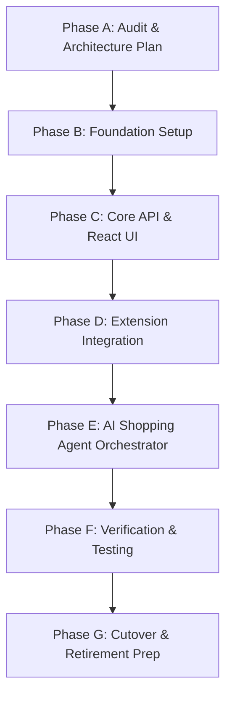

# Honest AI Migration Plan: Laravel to Python (FastAPI) & React (TypeScript)

**Version:** 1.0.0  
**Status:** Approved for Execution  
**Target Architecture:**
- **Backend:** Python 3.11+, FastAPI, Pydantic v2
- **Database & ORM:** PostgreSQL, SQLAlchemy 2.0 (Async + Sync support), Alembic
- **AI Agent Orchestrator:** OpenAI Agents SDK / Structured Tool Calling Framework with Modular Provider Adapters
- **Frontend:** React 18/19, TypeScript, Vite, Vanilla/Tailwind-compatible modern CSS tokens
- **Browser Extension:** Preserved Manifest V3 with environment-aware API endpoints
- **Testing:** pytest with full mock fixtures, component tests, API integration tests

---

## 1. Migration Principles & Safety Rules

1. **Strict Data & Code Preservation:** The existing Laravel project remains intact throughout development. No files in `app/`, `database/`, or `resources/` are overwritten or deleted until the migration passes all acceptance tests.
2. **Backward-Compatible API Contracts:** The new FastAPI backend must implement identical HTTP endpoints and response schemas so that the existing browser extension continues to function seamlessly without breaking changes.
3. **Privacy & Local Storage Integrity:** User chat histories will continue to be stored in the browser's `localStorage` for privacy, while user authentication, product catalog, and community material reviews are stored in PostgreSQL.
4. **Transparent Data Sourcing & Zero Hallucination:** Product details, prices, material specifications, and seller ratings must never be fabricated. Where external data is unavailable or heuristic, it will be clearly labeled as unverified or heuristic.
5. **No Secrets in Source Control:** Database credentials, API keys, and JWT secrets must be loaded strictly from environment variables via Pydantic Settings.

---

## 2. Phased Execution Roadmap



---

### Phase A — Audit & Plan (Completed)
- [x] Inspect existing Laravel codebase, models, controllers, services, migrations, and routes.
- [x] Inspect browser extension manifest, background service worker, and content scripts.
- [x] Verify Git availability and create baseline commit to prevent any accidental loss.
- [x] Produce architecture audit, migration plan, feature mapping, and security plan.

---

### Phase B — Foundation Setup
- [ ] Create target directory structure:
  ```text
  backend/
    app/
      api/
      core/
      db/
      models/
      schemas/
      repositories/
      services/
      agents/
    alembic/
    tests/
    pyproject.toml / requirements.txt
    .env.example
  frontend/
    src/
    public/
    package.json
    vite.config.ts
    .env.example
  extension/
    manifest.json
    background.js
    content.js
    style.css
    config.js
  docker-compose.yml
  ```
- [ ] Set up Python virtual environment and dependencies (`fastapi`, `uvicorn`, `sqlalchemy>=2.0`, `alembic`, `pydantic>=2.0`, `pydantic-settings`, `passlib`, `bcrypt`, `python-jose`, `httpx`, `pytest`, `pytest-asyncio`).
- [ ] Initialize PostgreSQL database configuration and Alembic migration environment.
- [ ] Create `docker-compose.yml` for local PostgreSQL and Redis services.
- [ ] Initialize React + TypeScript + Vite frontend project in `frontend/`.

---

### Phase C — Core Application Migration
- [ ] **SQLAlchemy Models:**
  - `User`: email, hashed password, name, timestamps.
  - `VerifiedProduct`: specs, genuine vs fake materials, prices across 3 tiers, telltales, recommended sources.
  - `StoreReputation`: platform, specialty tier, trust score, honesty rating, verified URLs.
  - `Review`: user relations, product name, tier, ratings, prices paid, upvotes.
  - `SearchSession` & `SearchRequest`: optional persistence for user queries when opted in.
- [ ] **Alembic Migrations:**
  - Create initial migration scripts mirroring and extending Laravel schemas.
  - Seed baseline catalog data (Sony XM5, Rolex Submariner, Jordan 4, Dyson Airwrap, Louis Vuitton Neverfull, Essentials Hoodie).
- [ ] **FastAPI Core Services:**
  - `IntentParserService`: NLP parsing of queries, budget detection in USD/EGP, category detection.
  - `ScoringEngineService`: Value-for-Money 4-part weighted scoring, letter grades, and badge logic.
  - `ReviewSentimentService`: Buyer consensus and durability analysis.
  - `CatalogService` & `ReviewService`: Database repository pattern with clean dependency injection.
  - `AuthService`: Password hashing compatible with Laravel bcrypt, JWT token generation, `/api/auth/login`, `/api/auth/register`, `/api/auth/me`.
- [ ] **React Frontend Application:**
  - Replicate ChatGPT-style responsive layout: collapsible sidebar, new chat, local chat history.
  - Quality tier selector (Original, High Copy, Budget Copy).
  - Multi-tier price matrix cards and material authenticity cards.
  - Settings modal with custom Gemini API key management.
  - Community reviews modal and store reputation explorer.
  - User authentication modals and state.
  - Internationalization support (English & Arabic RTL).

---

### Phase D — Browser Extension Migration
- [ ] Canonicalize extension files in `extension/`.
- [ ] Introduce configurable `config.js` or storage-based API URL setting with fallback to `http://localhost:8000`.
- [ ] Maintain full Manifest V3 compatibility.
- [ ] Ensure all 8 message handlers in `background.js` connect cleanly to FastAPI endpoints.
- [ ] Validate Shadow DOM rendering, interactive split-slider, lighting simulator, and video embed player.
- [ ] Write automated integration tests for extension-to-backend communication.

---

### Phase E — AI Shopping Agent Architecture
- [ ] **Provider-Adapter Layer:**
  - Standard interface `ProductDataProvider` with methods: `search()`, `get_details()`, `get_price()`, `get_reviews()`.
  - Concrete adapters:
    - `VerifiedCatalogAdapter`: Searches verified internal database specs and telltales.
    - `LiveWebSearchAdapter` / Mock Store Adapter: Authorized search with real source URLs.
    - `GeminiVlmAdapter`: Multimodal visual forensic comparison with schema validation.
- [ ] **Agent Orchestrator:**
  - Parse user intent and identify category, budget, constraints, and destination.
  - Execute tool calls deterministically: `search_products`, `get_product_details`, `get_current_price`, `compare_products`, `rank_products`.
  - Deduplicate variants and assess 3 tiers (Original, High Copy 1:1, Budget Copy).
  - Compute category-appropriate VFM scores with transparent trade-offs and confidence scores.
  - Output structured JSON payloads with timestamps and source URLs.

---

### Phase F — Verification & Automated Testing
- [ ] **Backend pytest suite:**
  - Health check endpoint verification.
  - Database connectivity and Alembic migrations.
  - User authentication, password verification, token issuance.
  - Intent parser with edge cases (greetings, open recommendations, specific product audits).
  - Scoring engine calculations and grade boundaries.
  - Review and catalog API endpoints.
  - Agent tool execution and error handling with mocked external calls.
- [ ] **Frontend tests & build:**
  - Vite production build test (`npm run build`).
  - API client error handling tests.
- [ ] **Extension validation:**
  - Load unpacked extension and verify backend communication.

---

### Phase G — Cutover Preparation & Documentation
- [ ] Update root `README.md` with complete Windows and cross-platform setup instructions.
- [ ] Document data migration runbooks from MySQL/SQLite to PostgreSQL.
- [ ] Provide rollback instructions.
- [ ] Keep old Laravel implementation alongside until final acceptance sign-off.
